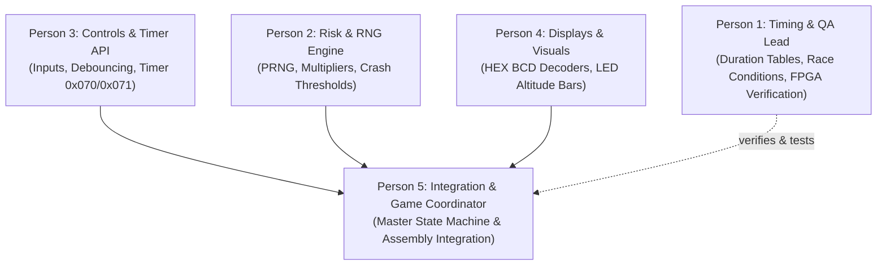

# Rocketship Game: 5-Person Team Responsibilities & Architecture

**Project:** ECE 2031 SCOMP Pausable Countdown Timer Demonstration  
**Target Platform:** Georgia Tech SCOMP Processor on Altera DE10-Lite FPGA  
**Primary Language:** SCOMP Assembly (`scasm`)  
**Peripheral Addresses:** `TIMER_VALUE` = `0x070`, `TIMER_CONTROL` = `0x071`

---

## 1. Overview & Collaboration Architecture

Because the SCOMP assembler (`scasm`) compiles a single flat `.asm` file without native multi-file linking, work is organized into **modular subroutines** sharing a **strict RAM variable contract**. 

Team members 2, 3, and 4 develop and test their subroutines independently as modular blocks. Person 1 defines timing tables, validates corner cases, and leads hardware testing. Person 5 integrates all routines into the master game program (`software/RocketGame.asm`).



---

## 2. Shared RAM Contract (Interface)

To prevent variable name collisions and ensure subroutines communicate seamlessly, all team members adhere to these standardized RAM variables:

```asm
; ============================================================
; SHARED MEMORY CONTRACT (RAM VARIABLES)
; ============================================================
BankedCredits:   DW 100     ; Total banked credits carried across rounds
CurrentStake:    DW 10      ; Current round wager amount
CurrentStage:    DW 1       ; Current active stage (1, 2, or 3)
CurrentPayout:   DW 0       ; Calculated winnings for current stage
RemainingTicks:  DW 0       ; Deciseconds remaining (read from 0x070)
TimerDoneFlag:   DW 0       ; Timer expired flag (0 = running/paused, 1 = done)
CrashFlag:       DW 0       ; Crash result (0 = safe/survived, 1 = crashed)
GamePaused:      DW 0       ; Pause status (0 = active, 1 = paused)
PRNG_Seed:       DW &HACE1  ; Seed state for pseudorandom generator
```

---

## 3. Individual Responsibilities

---

### **Person 1: Timing Calibration & Hardware Verification Lead**
* **Title:** QA, Hardware Validation & Timing Lead
* **Primary Objective:** Ensure timer integration is rock-solid, define game pace/durations, and lead board-level verification on the DE10-Lite FPGA.

#### Deliverables & Responsibilities:
1. **Stage Duration & Pacing Specification:**
   - Define decisecond values for each rocket stage in software:
     - **Stage 1 (Launch):** 5.0 seconds (50 deciseconds)
     - **Stage 2 (Orbit/Boost):** 3.5 seconds (35 deciseconds)
     - **Stage 3 (Deep Space):** 2.0 seconds (20 deciseconds)
   - Validate that durations give players sufficient reaction time without stalling gameplay.
2. **Timing Edge & Corner Case Testing:**
   - **Race Conditions:** Verify behavior if a player presses "Cash Out" or "Risk" on the exact tick the timer reaches 0 (`DONE = 1`).
   - **Rapid Pause/Resume:** Verify no time loss occurs when toggling pause repeatedly during a stage countdown.
   - **Stage Reset Cleanness:** Verify that reloading duration between stages clears `DONE` without glitching the controller.
3. **Hardware Test Protocol & Demonstration Evidence:**
   - Maintain the FPGA test bench and run end-to-end check-offs.
   - Record and log proof of all acceptance criteria (video demo, state transitions, win/loss verification).

---

### **Person 2: Risk Engine & Multiplier Math (PRNG)**
* **Title:** Gameplay Odds, Randomness & Multiplier Engineer
* **Primary Objective:** Implement pseudorandom number generation and multiplier arithmetic in SCOMP assembly.

#### Deliverables & Responsibilities:
1. **16-bit PRNG Routine (`Sub_PRNG`):**
   - Implement a lightweight SCOMP PRNG (such as an LFSR or LCG algorithm using shift/XOR/add).
   - Re-seed PRNG dynamically from switch toggle jitter or timer ticks to avoid repetitive sequences.
2. **Crash Probability Evaluation (`Sub_RollCrash`):**
   - Compare PRNG output against calibrated risk thresholds:
     - **Stage 1:** ~10% crash chance
     - **Stage 2:** ~30% crash chance
     - **Stage 3:** ~60% crash chance
   - Set `CrashFlag = 1` on failure, `CrashFlag = 0` on survival.
3. **Multiplier Arithmetic (`Sub_CalcPayout`):**
   - Because SCOMP lacks a hardware multiplier/divider, implement fixed multipliers using shift-and-add operations:
     - **Stage 1 (1.5×):** $\text{Payout} = \text{Stake} + (\text{Stake} \gg 1)$
     - **Stage 2 (3.0×):** $\text{Payout} = (\text{Stake} \ll 1) + \text{Stake}$
     - **Stage 3 (6.0×):** $\text{Payout} = (\text{Stake} \ll 2) + (\text{Stake} \ll 1)$
   - Store result in `CurrentPayout`.

---

### **Person 3: Player Controls & Timer I/O Wrapper**
* **Title:** I/O Controls & Peripheral API Specialist
* **Primary Objective:** Interface with the memory-mapped countdown timer peripheral (`0x070`, `0x071`) and implement clean input debouncing/edge detection.

#### Deliverables & Responsibilities:
1. **Input Edge Detection & Debounce (`Sub_PollInputs`):**
   - Read switches/pushbuttons (`0x000`).
   - Implement single-edge detection (requiring button release before re-triggering) so players cannot hold switches down to spam commands.
   - Map controls cleanly:
     - `SW0`: Launch / Next Stage (Risk)
     - `SW1`: Cash Out
     - `SW2`: Pause / Resume
     - `SW3`: Reset / Replay Round
2. **Timer Peripheral API Wrappers:**
   - `Sub_TimerLoad`: Loads AC into `TIMER_VALUE` (`0x070`).
   - `Sub_TimerStart`: Writes `1` to `TIMER_CONTROL` (`0x071`).
   - `Sub_TimerPause`: Writes `0` to `TIMER_CONTROL` (`0x071`).
   - `Sub_TimerReset`: Writes `2` to `TIMER_CONTROL` (`0x071`).
   - `Sub_TimerCheck`: Reads `0x071`, extracts Bit 1 (`DONE`) into `TimerDoneFlag`, and reads `0x070` into `RemainingTicks`.
3. **Pause Interlock:**
   - Guarantee that when `GamePaused = 1`, all player action inputs (Cash Out, Risk) are locked until unpaused.

---

### **Person 4: Displays, HEX Decoding & Visuals**
* **Title:** User Interface & Visual Feedback Developer
* **Primary Objective:** Provide clear, dynamic visual feedback on DE10-Lite 7-segment displays (HEX) and LEDs for game states, timers, and animations.

#### Deliverables & Responsibilities:
1. **LED Altitude & Flight Progress (`Sub_UpdateLEDs`):**
   - Map LEDs (`0x001`) to reflect rocket progress:
     - **Launch & Ascent:** Progressive bar fill from bottom to top (`0000000001` $\rightarrow$ `0000000111` $\rightarrow$ `1111111111`).
     - **Crash Animation:** Alternating pattern flash (`1010101010` / `0101010101`).
     - **Cash Out / Win Animation:** Full bar strobe / marquee pattern.
2. **HEX Display Decoding (`Sub_UpdateHEX`):**
   - **Remaining Time:** Output `RemainingTicks` formatted on `HEX1-HEX0` (e.g., `3.5` seconds).
   - **Score / Multiplier / Status:** Output stage or banked credits on `HEX3-HEX2`.
   - **Text Messages:** Display alphanumeric status codes:
     - `"GO"` on launch
     - `"PAUS"` on pause
     - `"WIN"` on successful cash-out
     - `"LOSE"` on crash or timeout

---

### **Person 5: Game Loop Coordinator & Master Integration**
* **Title:** Lead Assembly Integrator & Game Architect
* **Primary Objective:** Maintain the master file `software/RocketGame.asm`, architect the master finite state machine (FSM), and merge everyone's subroutines.

#### Deliverables & Responsibilities:
1. **Master Program Architecture (`RocketGame.asm`):**
   - Establish memory layout, subroutine ordering, and RAM variable table.
   - Lead merge sessions to integrate subroutines from Persons 2, 3, and 4.
2. **Master Finite State Machine (FSM):**
   - Implement the game loop states:
     - `STATE_TITLE_READY`: Display banked credits; wait for Launch button press.
     - `STATE_STAGE_START`: Deduct stake, load stage duration via Person 3 API, start timer.
     - `STATE_RUNNING`: Poll inputs, update displays, monitor `TimerDoneFlag`.
     - `STATE_PAUSED`: Freeze hardware timer, halt animations, wait for resume.
     - `STATE_RISK_CHECK`: Trigger Person 2 crash roll. If survived $\rightarrow$ advance stage; if failed $\rightarrow$ `STATE_CRASH`.
     - `STATE_CASHOUT`: Calculate payout, add to `BankedCredits`, display victory animation.
     - `STATE_CRASH / TIMEOUT`: Display lose animation, deduct stake, check if player has remaining credits.
     - `STATE_REPLAY`: Allow new game round without FPGA reconfiguration.

---

## 4. Responsibility Matrix

| Deliverable / Feature | Primary Owner | Secondary / Support |
| :--- | :---: | :---: |
| **Timer API Calls (`0x070`, `0x071`)** | Person 3 | Person 1 |
| **Input Edge Detection / Debounce** | Person 3 | Person 5 |
| **PRNG Algorithm & Crash Roll** | Person 2 | Person 5 |
| **Multiplier Math (1.5×, 3×, 6×)** | Person 2 | Person 5 |
| **HEX 7-Segment Drivers & Text Codes** | Person 4 | Person 3 |
| **LED Altitude Bar & Visual FX** | Person 4 | Person 1 |
| **Stage Timing Table (5.0s, 3.5s, 2.0s)** | Person 1 | Person 5 |
| **Corner Cases & Hardware Timing Tests** | Person 1 | Person 4 |
| **Master State Machine & Game Integration** | Person 5 | All Members |
| **Final Board Demo & Video Check-off** | Person 1 | Person 5 |

---

## 5. Development & Assembly Milestones

1. **Phase 1: Subroutine Staging (Independent)**
   - Persons 2, 3, 4 write and self-test their isolated code blocks using scratch labels.
   - Person 1 establishes timing tables and verifies register stability on hardware.
2. **Phase 2: Master Assembly Merge**
   - Person 5 combines all modules into `software/RocketGame.asm`.
   - Verify zero label collisions and that RAM addresses match the Shared Contract.
3. **Phase 3: Final Verification on DE10-Lite**
   - Person 1 and Person 5 run full gameplay cycles on the FPGA board.
   - Confirm pause integrity, cash-out accuracy, crash probabilities, and replayability.
