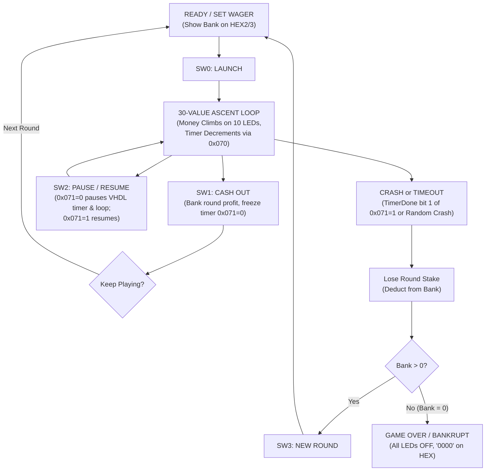

# Rocket Multiplier Game: Push-Your-Luck Survival Architecture
**Demonstration Application for the PausableCountdownTimerAPI Peripheral**  
**Course:** ECE 2031 Digital Design Laboratory  
**Target Hardware:** Altera DE10-Lite FPGA Board with SCOMP  
**Hardware API Sources:** `hardware/rtl/countdown_peripheral.vhd` (in `PausableCountdownTimerAPI`)  
**Memory-Mapped Addresses:** `TIMER_VALUE` = `0x070`, `TIMER_CONTROL` = `0x071`

---

## 1. Game Concept: Push-Your-Luck Survival (No "Win" Screen)

There is **no arbitrary "Win" condition** in this game. You either choose to cash out and walk away with your profit for the round, or you keep pushing your luck until you crash and **lose all your money (Bankruptcy / Game Over)**:



### Core Gameplay Loop:
1. **The Round:** 
   - Player stakes credits (e.g. 10 credits).
   - Pressing **SW0 (Launch)** loads duration into the `PausableCountdownTimerAPI` (`0x070`), starts countdown (`0x071 <= 1`), and initiates the 30-value climb.
   - The game sequentially steps through an array of **30 increasing values**.
2. **Visual Feedback on 10 LEDs (`0x001`):**
   - The 10 board LEDs act as a thermometer meter displaying the rising money.
   - Every 3 steps illuminates an additional LED:
     - Steps 0–2: 1 LED (`0x0001`)
     - Steps 3–5: 2 LEDs (`0x0003`)
     - ...
     - Steps 27–29: 10 LEDs (`0x03FF`) (Maximum round multiplier).
3. **Player Decisions (Switches at `0x000`):**
   - **SW0 (Launch):** Starts round and countdown.
   - **SW1 (Cash Out):** Locks in `CurrentMoney`, writes `0` to `0x071` to freeze the timer, adds winnings to `BankedCredits`, and safely banks the profit for that round.
   - **SW2 (Pause / Resume):** Calls the hardware timer API (`0x071 <= 0` to pause, `0x071 <= 1` to resume). Freezes both the VHDL hardware timer and the 30-value climb. All decision inputs are locked out while paused.
   - **SW3 (Replay / Next Round):** Prepares state for the next launch.
4. **Crash, Timeout & Bankruptcy:**
   - If the player gets too greedy and does not cash out before:
     - The hardware timer reaches 0 (Bit 1 `DONE` of `0x071` trips high), OR
     - The loop reaches the randomized `CrashThreshold` (1..30).
   - **Bust!** The stake is lost, LEDs flash an alternating hazard pattern, and `BankedCredits` is reduced.
   - **Game Over:** If `BankedCredits <= 0`, player is bankrupt. The game locks down until full board reset.

---

## 2. Hardware Timer Integration (`PausableCountdownTimerAPI`)

The countdown is handled completely in hardware by the VHDL peripheral developed in this repo (`hardware/rtl/countdown_peripheral.vhd`), which combines:
- `countdown_core.vhd`: Tick generator (10 MHz / 1,000,000 = 0.1s tick) and decisecond counter.
- `countdown_controller.vhd`: Running/Paused/Done state logic and reload strobes.
- `countdown_io.vhd`: SCOMP 11-bit address decoding and tri-state bus isolation.

### Register Interface:
| Address | Access | Function |
| :--- | :---: | :--- |
| `0x070` (`TIMER_VALUE`) | **WRITE** | Loads duration in deciseconds, pauses timer, clears `DONE`. |
| `0x070` (`TIMER_VALUE`) | **READ** | Reads live remaining deciseconds (drives HEX displays). |
| `0x071` (`TIMER_CONTROL`) | **WRITE** | `0` = Pause, `1` = Start/Resume, `2` = Reset. |
| `0x071` (`TIMER_CONTROL`) | **READ** | Bit 0 = `RUNNING` status, Bit 1 = `DONE` completion flag. |

---

## 3. Team Responsibilities & Template File Allocation

| Role | Developer | Deliverable File | Plain-English Instructions |
| :--- | :---: | :--- | :--- |
| **Role 1: Timer API** | **Person 1** | [Person1_TimerAPI.asm](file:///Users/danny/Projects/PausableCountdownTimerAPI/software/Person1_TimerAPI.asm) | Owns low-level subroutines interfacing with `0x070` and `0x071`. Implements duration loading, starting, pausing, resuming, and polling `DONE`. Validates zero-tick edge cases on FPGA. |
| **Role 2: Multiplier Table & Crash** | **Person 2** | [Person2_MultiplierTable.asm](file:///Users/danny/Projects/PausableCountdownTimerAPI/software/Person2_MultiplierTable.asm) | Defines the 30 pre-computed payout values in RAM. Implements step advance and the pseudorandom crash threshold roll (LFSR) so the rocket crashes at unexpected heights. |
| **Role 3: Switch Controls & Debounce** | **Person 3** | [Person3_SwitchControls.asm](file:///Users/danny/Projects/PausableCountdownTimerAPI/software/Person3_SwitchControls.asm) | Handles reading `0x000`. Writes rising-edge detection (release-to-trigger) so held switches don't spam. Handles Cash Out (SW1), Launch (SW0), Pause toggle (SW2), and Reset (SW3). |
| **Role 4: LED Money Meter & HEX** | **Person 4** | [Person4_DisplaysLEDs.asm](file:///Users/danny/Projects/PausableCountdownTimerAPI/software/Person4_DisplaysLEDs.asm) | Translates the 30 steps into 10 LEDs on `0x001` (thermometer bar). Handles Cash-Out flash, crash hazard strobe, and outputs remaining time / bank balance to HEX displays (`0x004` & `0x005`). |
| **Role 5: Master Integration & FSM** | **Person 5** | [Person5_RocketGame_Master.asm](file:///Users/danny/Projects/PausableCountdownTimerAPI/software/Person5_RocketGame_Master.asm) | Lead integrator. Manages the master state loop (WaitLaunch $\rightarrow$ Running $\rightarrow$ CashOut / Bust $\rightarrow$ Bankrupt Check $\rightarrow$ Replay). Merges all 4 subroutines into `RocketGame.asm`. |

---

## 4. Shared RAM Contract (SCOMP Memory Map)

All 5 developers write their subroutines to read/write these exact standardized variables:

```asm
; ============================================================
; SHARED GAME STATE VARIABLES (SCOMP RAM)
; ============================================================
BankedCredits:   DW 100     ; Total player bankroll (game over when <= 0)
CurrentStake:    DW 10      ; Wager for the active round
CurrentValueIdx: DW 0       ; Step index (0 to 29) in 30-value array
CurrentMoney:    DW 0       ; Current payout looked up from array
CrashThreshold:  DW 24      ; Randomized crash cutoff index (8 to 30)
RemainingTicks:  DW 0       ; Deciseconds read from 0x070
TimerDoneFlag:   DW 0       ; Bit 1 of 0x071 (1 = expired/timeout)
GamePaused:      DW 0       ; Pause status (0 = running, 1 = paused)
CrashFlag:       DW 0       ; Crash status (1 = crashed, 0 = safe)
PRNG_Seed:       DW &HACE1  ; Seed for pseudo-random crash generator
```

---

## 5. Course Project Summary Report (ECE 2031 Deliverable)

Refer to [PROJECT_SUMMARY_GUIDE.md](file:///Users/danny/Projects/PausableCountdownTimerAPI/docs/PROJECT_SUMMARY_GUIDE.md) for strict grading compliance with `2031_AssignmentSheet_ProjectSummary (1).pdf`:
* **Length:** Under 650 words total.
* **Topic:** The **Pausable Countdown Peripheral (`PausableCountdownTimerAPI`)**, NOT the game. The game is cited only as the functional validation test.
* **Division:**
  * Section 1 (*Introduction*) & Section 4 (*Conclusions*): Written **individually** by each person.
  * Section 2 (*Device Functionality*) & Section 3 (*Design Decisions & Implementation*): Written **collectively** by the team.
